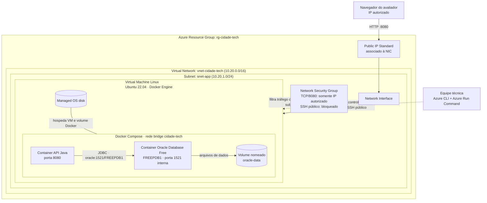

# Arquitetura Cloud — Cidade Tech

## Diagrama de infraestrutura

## Caminho da requisição e dos dados

1. O navegador acessa o IP público da VM na porta 8080.
2. O Public IP está associado à NIC da VM; a NSG vinculada à subnet permite a
   porta da API somente a partir do IP autorizado.
3. A porta publicada do container encaminha a requisição à API Java.
4. A API conecta-se ao serviço `oracle` pela rede bridge do Compose e grava/lê
   os dados no Oracle.
5. O volume nomeado `oracle-data` mantém os arquivos do banco quando o container
   é reiniciado ou recriado.

A porta 1521 não é publicada no host nem liberada na NSG. Apenas os serviços da
rede Docker conseguem acessar o listener Oracle. A administração da VM usa
Azure Run Command, sem expor SSH à Internet.

## Recursos Azure

| Recurso | Função nesta demonstração |
| --- | --- |
| Resource Group | Agrupa e permite remover os recursos dedicados ao projeto. |
| VNet e subnet | Delimitam a rede privada onde a VM e sua NIC estão conectadas. |
| NSG | Limita o tráfego de entrada à porta da API e ao IP autorizado. |
| Public IP Standard | Permite ao avaliador alcançar a API da VM. |
| NIC | Conecta a VM à subnet e associa o Public IP. |
| Linux VM e Managed OS disk | Hospedam Docker, Compose, API, Oracle e o volume persistente. |

O desenho usa uma VM porque a entrega exige execução em VM Azure e o prazo é
curto. Separar API e banco em containers dá isolamento e comunicação explícita,
sem adicionar recursos gerenciados ou custos de múltiplas VMs. O Azure continua
responsável pela rede e pelo acesso externo; o Compose gerencia a integração
interna dos serviços.

## Limites e segurança

É uma arquitetura de demonstração, com ponto único de falha e sem alta
disponibilidade, domínio ou HTTPS. A regra de entrada deve ser restrita ao IP do
avaliador, credenciais devem permanecer fora do Git e o banco deve receber
apenas dados sintéticos. O volume reside no disco da VM; faça cópia dos dados
antes de remover recursos que possam destruir esse disco.

O serviço `api` no Compose é um esqueleto de integração: a API Java e seu
Dockerfile ainda precisam ser entregues pela equipe responsável. O endereço JDBC
e as variáveis deverão ser confirmados com essa equipe.
